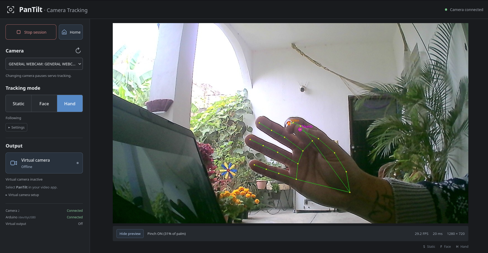
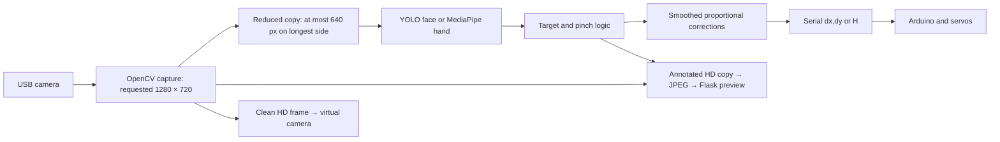

# PanTilt · Camera Tracking

A Python and OpenCV project that controls a two-axis camera mount from face
or hand detections. A local Flask interface provides an HD preview, tracking
controls, and a clean virtual-camera feed for video applications.

OpenCV handles camera capture, image resizing, color conversion, drawing and
JPEG encoding. Pretrained YOLO and MediaPipe models provide detections; the
Python application converts them into relative servo commands for Arduino.

## Preview



## Features

| Control | Behavior |
| --- | --- |
| Start / Stop session | Open or release the camera, models and session resources. |
| Camera source | Select a physical Linux camera; switching pauses servo tracking. |
| Static | Show video without running detection or following a target. |
| Face (`F`) | Follow the center of the largest detected face. |
| Hand (`H`) | Follow the index fingertip only while holding a thumb-index pinch. |
| Static (`S`) | Hold the current position; it does not return the mount home. |
| Home | Switch to Static and return toward pan **80°**, tilt **100°**. |
| Settings | Pause servo tracking and tune relative pinch sensitivity live. |
| Virtual camera | Toggle clean output; the button shows Offline, Starting… or Live. |
| Hide / Show preview | Skip local JPEG encoding and browser streaming while tracking and virtual output continue. |

Selecting Face or Hand automatically enables servo tracking, except in
`--preview-only` mode. The pinch setting is saved between app launches.
Session controls are shared by every browser tab connected to the app.

## How it works



Only the selected detector runs each frame. With 720p capture, its input copy
is 640×360; YOLO additionally uses `imgsz=320`. Preview and virtual output keep
the actual captured size. A requested 30 FPS is not a guaranteed processing
rate: capture, inference and output share one worker.

## Requirements

- Linux with V4L2 support; developed and tested on CachyOS.
- Python with compatible wheels for the versions in [requirements.txt](requirements.txt).
- USB camera, Arduino with two servos, and the Arduino **Servo** library.
- Read/write access to the selected camera and serial device.
- Two downloaded model files, listed below.
- Optional: `v4l2loopback` for virtual-camera output. OBS is not required.

OpenCV, NumPy and PyTorch are installed through the current dependency chain.
Use a virtual environment rather than modifying system Python packages.

## Setup

```bash
git clone https://github.com/xJosephMorganx/smart-camera-tracking.git
cd smart-camera-tracking
python -m venv .venv
.venv/bin/python -m pip install -r requirements.txt
mkdir -p models
```

Download the following assets from their publishers and save them with these
exact names. Model weights are **not included in Git**.

| Local path | Purpose | Publisher |
| --- | --- | --- |
| `models/yolov8n-face.pt` | Face-specific YOLO weights | [YOLO Face repository](https://github.com/akanametov/yolo-face) |
| `models/hand_landmarker.task` | MediaPipe hand model bundle | [MediaPipe Hand Landmarker](https://ai.google.dev/edge/mediapipe/solutions/vision/hand_landmarker/python) |

Both assets are required when starting a session, including Static mode,
because the worker initializes both models once per session. It does not
train models or download them automatically.

Open [firmware/pan_tilt/pan_tilt.ino](firmware/pan_tilt/pan_tilt.ino) in Arduino
IDE, choose your board and port, and upload it if the matching firmware is
not already installed. Close Serial Monitor before running the app.

| Hardware setting | Value |
| --- | --- |
| Pan signal | Arduino pin 9 |
| Tilt signal | Arduino pin 10 |
| Serial baud rate | 115200 |
| Home angles | Pan 80°, tilt 100° |
| Firmware angle limits | 0–180° |

Use a servo supply appropriate to the motors and a common ground with the
Arduino. Signal pins do not supply motor power. Mechanical limits depend on
the mount; the software's 0–180° bounds are not a physical calibration.

## Run

From the project root:

```bash
.venv/bin/python python/web_app.py --camera 2
```

Open [PanTilt](http://127.0.0.1:5000), select a camera, and click **Start session**.
A fresh app starts in Static mode. To test detection and video without servo
access:

```bash
.venv/bin/python python/web_app.py --camera 2 --preview-only
```

| Option | Default | Purpose |
| --- | --- | --- |
| `--camera` | `2` | Initial camera index or stable `/dev/v4l/by-id/...` path. |
| `--serial-port` | `/dev/ttyUSB0` | Arduino serial device. |
| `--virtual-device` | `/dev/video10` | Virtual-camera output device. |
| `--port` | `5000` | Local HTTP port. |
| `--preview-only` | Off | Disable serial access, Home and servo motion. |

Use **Stop session** or Ctrl+C to release hardware. Closing the browser tab
alone does not stop the worker. Run one Flask process, without a reloader.

## Virtual-camera output

When the kernel provides `v4l2loopback`, create a device using an unused video
number:

```bash
sudo modprobe v4l2loopback video_nr=10 card_label=PanTilt exclusive_caps=1
```

Start a session, click **Virtual camera**, wait for **Live**, and select
**PanTilt** in your video application. The virtual feed excludes tracking
markers; audio is handled separately. If the module is unavailable, install
the package matching your distribution and kernel. See the
[usage guide](docs/web-interface.md#virtual-camera-output-on-cachyos) for details.

## Documentation

- **[Usage and troubleshooting](docs/web-interface.md)** — controls, virtual
  output, camera selection, pinch, Home and resolution settings.

## Project structure

```text
smart-camera-tracking/
├── python/
│   ├── web_app.py              # Flask routes and command-line entry point
│   ├── tracking_service.py     # Camera, inference, serial and output worker
│   ├── tracking_config.py      # Model paths, resolutions and control constants
│   ├── motion_control.py       # Filtering and relative servo corrections
│   ├── tracking_targets.py     # Face/hand targets, pinch and annotations
│   ├── hand_detector.py        # MediaPipe adapter and timestamps
│   ├── camera_devices.py      # Linux camera discovery
│   ├── local_settings.py      # Pinch preference persistence
│   ├── templates/index.html   # Interface markup
│   └── static/                # app.css and app.js
├── firmware/pan_tilt/
│   └── pan_tilt.ino            # Arduino serial receiver and servo control
├── models/                    # Downloaded assets; ignored by Git
├── config/local-settings.json # Local pinch setting; generated and ignored
├── docs/
│   ├── web-interface.md
│   └── images/camera-studio.png
├── tests/                     # Synthetic image, API and mocked hardware tests
├── requirements.txt
├── README.md
└── LICENSE
```

## Validation and limitations

```bash
.venv/bin/python -B -m unittest discover -s tests -v
node --check python/static/app.js
```

Node is only needed for the optional JavaScript syntax check, not to run the
app. The 34 automated tests cover control logic, pinch, HD coordinate mapping,
API validation, Home, preview visibility and resource cleanup. They use
simulated hardware and do not measure real servo accuracy or camera FPS.

The system performs face **detection**, not identity recognition. It selects
one face or one hand; it does not maintain a persistent person identity.
Occlusion, lighting, camera pose and CPU load can affect results. Arduino
returns no position acknowledgments, so Home completion means its command
sequence was sent, not that physical arrival was measured.

## License

GPL-3.0-only; see [LICENSE](LICENSE). Third-party libraries and model weights
retain their own licenses and terms.
