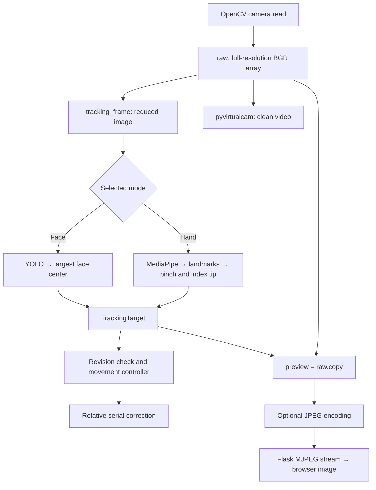

# PanTilt: Python and OpenCV code walkthrough

This guide explains the implemented application, with enough detail to read
the source and present it in class. Read it alongside the linked files;
short code examples below illustrate the real algorithms but omit some
validation and cleanup. They are not replacement scripts.

## 1. Project objective and scope

The goal is to keep a visual target near the center of a camera image by
moving a pan-tilt mount. Python reads camera frames, detects a target,
calculates a correction and sends it to an Arduino. The Arduino applies the
correction to two servo angles. Flask exposes the controls and preview in a
browser instead of using `cv2.imshow()`.

There are three operating modes:

| Mode | Target | Condition for movement |
| --- | --- | --- |
| Static | None | No automatic following. Explicit Home is still available. |
| Face | Center of the largest face rectangle | A valid face and enabled servo tracking. |
| Hand | Index fingertip | Valid hand landmarks, an active pinch and enabled servo tracking. |

This is a visual feedback system: a correction changes the camera direction,
and the next image supplies a new error. It does not measure servo shaft
position. The face model does not identify people, and this project does not
train either model. The custom work is the image pipeline, target selection,
gesture gating, movement policy, interface, state management and integration.

## 2. Responsibilities and reading order

| File | Main objects/functions | Why it exists |
| --- | --- | --- |
| [web_app.py](../python/web_app.py) | `main`, `create_app` | Parse CLI options and translate HTTP requests into service calls. |
| [tracking_service.py](../python/tracking_service.py) | `TrackingService`, `tracking_frame` | Own hardware and coordinate every frame of the session. |
| [tracking_targets.py](../python/tracking_targets.py) | `TrackingTarget`, `face_target`, `hand_target` | Convert model results into a common target and draw annotations. |
| [hand_detector.py](../python/hand_detector.py) | `HandDetector` | Convert OpenCV images into MediaPipe input. |
| [motion_control.py](../python/motion_control.py) | `MotionController`, `calculate_axis_step` | Convert target error into bounded relative commands. |
| [tracking_config.py](../python/tracking_config.py) | Constants | Keep resolutions, paths, signs and tuning easy to find. |
| [camera_devices.py](../python/camera_devices.py) | `list_cameras` | Discover usable physical V4L2 capture devices. |
| [local_settings.py](../python/local_settings.py) | Load/save/validate helpers | Persist the pinch ratio without restarting the app. |
| [app.js](../python/static/app.js) | `render`, `command`, `poll` | Synchronize browser controls with server state. |
| [Arduino sketch](../firmware/pan_tilt/pan_tilt.ino) | `setup`, `loop`, `approach` | Receive commands and write servo positions. |

Start with `TrackingService._run()`. It shows how the smaller modules fit
together. Then read target extraction and motion control before studying the
web interface.

## 3. What OpenCV does in this project

A frame is a NumPy array. At 720p its shape is `(720, 1280, 3)`: height, width,
and three BGR color channels. Coordinates use `x` horizontally and `y`
vertically, while array indexing uses `frame[y, x]`.

| Operation | Use in this code |
| --- | --- |
| `cv2.VideoCapture(source, cv2.CAP_V4L2)` | Open a Linux camera. |
| `camera.set(...)` | Request MJPEG, 1280×720, 30 FPS and a small capture buffer. |
| `camera.read()` | Return success plus the next decoded image. |
| `cv2.resize(..., INTER_AREA)` | Reduce the image for inference while preserving its proportions. |
| `cv2.cvtColor(..., COLOR_BGR2RGB)` | Convert BGR to RGB before MediaPipe. |
| `cv2.rectangle`, `line`, `circle`, `drawMarker`, `putText` | Draw detection and control information on the preview copy. |
| `cv2.imencode('.jpg', ...)` | Encode the annotated frame for browser streaming. |
| `camera.release()` | Release the capture device during cleanup or camera switching. |

OpenCV is central to the video pipeline, but it is not the face or hand model.
YOLO inference runs through Ultralytics; hand landmarks come from MediaPipe.
The capture pattern follows OpenCV's documented `VideoCapture` / `read` /
`release` lifecycle. [OpenCV video tutorial](https://docs.opencv.org/4.x/dd/d43/tutorial_py_video_display.html).

## 4. Startup and one complete frame

`web_app.main()` constructs a `TrackingService` and starts Flask on
`127.0.0.1`. Loading the page does not open the camera or Arduino. Clicking
**Start session** calls `POST /api/session/start`, which launches one worker
thread using `TrackingService.start()`.

The worker checks that both model files exist, initializes YOLO and
MediaPipe, opens the camera, and creates a `MotionController` without a
serial connection. Both models are loaded even in Static mode, but neither
runs inference in Static mode.

The per-frame loop follows this sequence:

1. Copy the requested settings and their `revision` while holding the lock.
2. Apply camera changes; close the old virtual producer if its source changes.
3. Open serial only when tracking or Home needs it. Wait two seconds for the
   Arduino startup, then send a zero correction.
4. Advance a pending Home sequence and reset filter/pinch history if controls changed.
5. Read the camera into `raw`; stop the session with an error if reading fails.
6. Create `preview = raw.copy()` and, for a tracking mode, a reduced image.
7. Run only the selected detector; extract a `TrackingTarget` and annotations.
8. Recheck `revision` and the stop flag before issuing movement. Discard stale
   results if a user changed controls during inference.
9. Send the clean `raw` image to the virtual camera when output is enabled.
10. Add the center marker and filtered target to `preview`, optionally encode
    it for the browser, and publish status/FPS.



The branches represent data use, not independent processing threads. Capture,
inference and output are sequential in the same worker.

## 5. HD output and smaller inference images

`tracking_config.py` requests capture at **1280×720**. The camera may negotiate
a different resolution, so the service reports the dimensions from actual
frames rather than assuming the request succeeded.

`tracking_frame()` computes:

```python
scale = min(1.0, 640 / max(height, width))
new_width = round(width * scale)
new_height = round(height * scale)
```

For 1280×720, `scale = 0.5`, producing 640×360. A 640×480 image stays unchanged.
The code never stretches a 16:9 image into 4:3 and never enlarges a small input.
`INTER_AREA` is the resize interpolation selected by this implementation.

| Stage | Typical size at 720p capture |
| --- | --- |
| `raw` and `preview` | 1280×720 |
| Shared detection input copy | 640×360 |
| YOLO inference size setting | `imgsz=320`; the library handles preprocessing/padding |
| MediaPipe input | 640×360 RGB; the library handles internal model processing |
| Browser stream | 1280×720 JPEG, quality 90 |
| Virtual-camera input | 1280×720 BGR, without preview annotations |

The browser's CSS display size is not the capture resolution. The virtual
output does not decode the browser JPEG or reuse the reduced inference image.
It receives `raw` directly. It can still undergo pixel-format conversion in
the virtual-camera backend and compression in a receiving video application.

## 6. Face detection and coordinate mapping

The worker calls:

```python
result = face_model.predict(
    detection_frame, imgsz=320, conf=0.5, verbose=False
)[0]
```

This is inference with the local face-specific weights, not generic person
detection. The prediction API returns bounding boxes; see the
[Ultralytics prediction reference](https://docs.ultralytics.com/modes/predict/).

`face_target()` obtains `result.boxes.xyxy`, converts it to a NumPy array, and
uses `largest_box_index()` to select the greatest rectangle area:

```text
area = (x2 - x1) × (y2 - y1)
```

YOLO's result coordinates refer to the supplied detection image. The code
maps them to preview coordinates with `preview_width / source_width` and
`preview_height / source_height`. A box `(100, 50, 200, 150)` in a 640×360 input
becomes `(200, 100, 400, 300)` in a 1280×720 preview. Its center is `(300, 200)`.

The center, not a facial landmark, becomes the target. No boxes means an
inactive target, so the controller holds position. Choosing the largest box
is simple and deterministic, but it can switch people when their apparent
sizes change; there is no persistent identity association.

## 7. Hand landmarks and relative pinch

`HandDetector.detect()` converts the reduced BGR image to RGB, creates a
MediaPipe image and calls `detect_for_video()`. Its timestamp is:

```python
timestamp_ms = max(last_timestamp_ms + 1, time.monotonic_ns() // 1_000_000)
```

This ensures strictly increasing timestamps even when frames arrive close
together or the user switches modes. The configured detector handles one
hand and uses 0.6 for detection, presence and tracking confidence thresholds.
The application uses 21 normalized hand landmarks from MediaPipe; it does not
use a per-fingertip confidence value. [MediaPipe Hand Landmarker](https://ai.google.dev/edge/mediapipe/solutions/vision/hand_landmarker/python).

`hand_target()` maps each normalized point back to HD pixel coordinates:

```python
pixel_x = landmark.x * width
pixel_y = landmark.y * height
```

Relevant landmark indices are 4 (thumb tip), 8 (index tip), 5 (index knuckle)
and 17 (pinky knuckle). The default movement target is landmark 8. A palm-center
alternative exists in the function but is not exposed by the interface.

The pinch calculation is:

```text
r = distance(thumb tip, index tip) / distance(index knuckle, pinky knuckle)
```

A 15-pixel tip gap with a 100-pixel palm gives `r = 0.15`. Moving closer might
produce a 30-pixel gap and a 200-pixel palm: the ratio remains 0.15. This is why
the threshold is a percentage of palm width rather than a fixed pixel count.
Distances are computed after conversion to pixels so image aspect ratio is
accounted for.

The default threshold is 0.20; the UI accepts 0.05–0.60. With hysteresis:

- An inactive pinch becomes active at `r <= threshold`.
- An active pinch remains active at `r <= threshold + 0.06`.
- At the default setting, activation is 20% and release occurs above 26%.

The gap between thresholds avoids rapid on/off changes near the boundary.
Missing, non-finite, out-of-image required points or a zero-width palm disable
movement. Uniform size changes cancel out, but hand rotation, perspective and
occlusion can still affect the ratio.

## 8. From a target to servo commands

`TrackingTarget` contains `position`, `active` and `status`. This common data
structure lets `MotionController` operate without knowing whether the target
came from a face or a hand.

### 8.1 Movement gate and smoothing

Movement requires both `enabled` and `target.active`. Otherwise the filter
is cleared and the controller sends zero corrections according to its timing
and transition rules.

An exponential moving average smooths target coordinates:

```text
filtered = (1 − alpha) × previous_filtered + alpha × measured
alpha = 0.65
```

The first valid target initializes the filter directly. Larger alpha values
favor the newest measurement; smaller values increase smoothing and delay.
Filtering reduces jitter but cannot remove camera/inference latency.

### 8.2 Resolution-independent error

The camera center is `(width / 2, height / 2)`. Control constants were tuned
using 640×480 coordinates, so errors are normalized:

```text
error_x = (target_x − width / 2) × 640 / width
error_y = (target_y − height / 2) × 480 / height
```

The same normalization is applied to measured and filtered positions. This
keeps a target at the same relative frame location from causing a larger
correction simply because the capture resolution increased. A changed field
of view can still change how scene movement maps to pixels.

### 8.3 Deadband, proportional gain and step limit

`calculate_axis_step()` returns zero if the current measured error is within
10 reference pixels of center, or if measured and filtered errors have
opposite signs. The latter stops stale smoothing history from continuing in
the old direction after the target crosses the center.

Otherwise `calculate_step()` applies:

```python
step = int(0.035 * filtered_error)
step = max(-3, min(3, step))
```

It also applies the deadband to the filtered error. `int()` truncates toward
zero, so small errors outside the 10-pixel deadband can still produce a zero
step. This is a bounded proportional controller with smoothing, not PID:
there is no integral or derivative term.

### 8.4 Numerical example and direction

Assume a first target at `(840, 450)` in a 1280×720 image:

```text
Center:                    (640, 360)
Raw error:                 (200, 90)
Normalized error:          (100, 60)
Proportional integer step: (3, 2)
Python signs:              PAN_SIGN=+1, TILT_SIGN=−1
Serial message:            "3,-2\n"
```

The firmware then executes `panPos -= dx` and `tiltPos += dy`. From the home
angles `(80, 100)`, that message requests `(77, 98)`. Direction depends on
both the Python signs and the physical servo mounting; changing only one
side can reverse following.

### 8.5 Timing and stop behavior

Normal corrections are sent no more frequently than every 0.05 seconds.
Stopping an active target or bringing an axis to zero can send an earlier
`0,0`. This prevents an early stop from repeating the other axis's movement.
The actual command rate may be lower if frames take longer to process.

The firmware treats each pair as a one-time angle increment, not a continuous
velocity. `0,0` means no angle change; it does not detach the servos or send
them home. `MotionController.stop()` also clears smoothing and timing state.

## 9. Serial protocol and Home

Python uses `pyserial` at 115200 baud and writes ASCII lines terminated by a
newline. It does not wait for acknowledgments.

| Message | Firmware behavior |
| --- | --- |
| `3,-2\n` | Subtract 3 from pan and add −2 to tilt, then constrain to 0–180°. |
| `0,0\n` | Keep the stored angles. |
| `H\n` | Approach pan 80° and tilt 100° by at most 2° per axis. |

The Arduino sketch attaches pan to pin 9 and tilt to pin 10. On startup it
writes the home angles. Python delays serial opening until a movement feature
needs it, avoiding an Arduino reset merely to view a Static camera session.

`TrackingService.home()` switches mode to Static, disables tracking,
increments `revision`, and schedules 50 `H` commands. The worker sends at
most one Home command per tick, with at least 50 ms between commands.
The greatest distance from either 0–180° limit to either home angle is 100°,
so 50 commands at 2° cover that range. `approach()` clamps each step to the
target; extra commands do not move past home.

Home takes about 2.5 seconds or longer depending on worker timing and serial
startup. Stop session cancels pending commands. There is no encoder reading
or firmware acknowledgment; completion is a sent-command condition only.

## 10. Flask, browser streaming and state

The Flask request handlers do not capture frames. They call the shared
service while its worker owns hardware. `settings` stores requested controls;
`state` stores phase, connections, measured dimensions, FPS and errors.
`snapshot()` combines them for the browser.

| Route | Purpose |
| --- | --- |
| `GET /` | Render the interface template and control token. |
| `GET /api/status` | Read current shared state. |
| `GET /api/cameras` | Enumerate physical cameras. |
| `POST /api/session/start` | Start the worker. |
| `POST /api/session/stop` | Request cleanup. |
| `POST /api/settings` | Change mode, tracking, virtual output, preview or pinch. |
| `POST /api/camera` | Select a physical camera. |
| `POST /api/home` | Schedule a return-home sequence. |
| `GET /stream.mjpg` | Stream the latest encoded preview as multipart JPEG. |

`app.js` polls status approximately every 750 ms after a request completes.
`command()` sends JSON with `X-Control-Token`, prevents overlapping local
commands, and refreshes controls from confirmed server state. F/H/S are browser
shortcuts; **H in the browser means Hand**, whereas **H on serial means Home**.

For video, `_frame()` encodes JPEG bytes and increments `sequence`. The
`frames()` generator waits on a `Condition` until the sequence changes, or a
two-second timeout occurs, then yields a multipart JPEG chunk. A slow browser
gets the latest stored frame rather than an unbounded queue of old frames.
This is MJPEG over HTTP, not WebRTC and not an OpenCV GUI window.

**Hide preview** removes the image source in the browser and skips subsequent
JPEG encoding in the worker. Detection, raw capture and virtual output stay
active. The current implementation still makes the preview copy and draws
annotations, so it does not eliminate all preview-related CPU work. Hiding
preview affects all tabs because the setting belongs to the shared session.

POST handlers validate a control token and reject mismatched Origin headers.
Flask also restricts trusted hosts and binds to loopback. These are local
control safeguards, not an account/login system for public deployment.

## 11. Concurrency, camera discovery and persistence

A `threading.Condition` backed by `RLock` protects shared settings and state.
Inference runs outside the lock so a slow model does not block every HTTP
request. Before serial correction, the worker compares the saved `revision`
with the current revision. A pause, Home or mode change during inference
invalidates the old result.

`threading.Event` communicates stop requests. A `finally` block attempts to
stop the controller and close virtual output, serial, MediaPipe and capture,
even when initialization fails partway through. Virtual-output errors have a
separate handler so detection and preview can continue when only that output
fails. Camera or serial failures stop the worker and expose an error.

`camera_devices.list_cameras()` queries V4L2 capabilities without starting a
capture stream. It excludes metadata-only entries and loopback drivers.
Selecting a different camera pauses tracking, releases the previous source,
and recreates virtual output at the new frame size if enabled.

Pinch changes are validated and saved to `config/local-settings.json`.
`local_settings.py` writes a temporary file, flushes and syncs it, then replaces
the settings file atomically. A failed save leaves the current in-memory
threshold unchanged. Missing or invalid saved settings use 0.20. Only pinch
is persisted; process startup defaults to Static, with motion/output off and
preview on. Stopping and starting a session in the same process can retain
other in-memory selections, so it is different from restarting the app.

## 12. Performance, observations and limitations

The `fps` metric counts completed worker frames over approximately half-second
windows. `inference_ms` includes resizing, the selected model call, target
extraction and its annotations. It excludes JPEG encoding, virtual output
and most capture work. Neither value measures full camera-to-screen or
camera-to-servo latency.

During one local check, the app reported about 21.6 FPS and 36.7 ms in Face
mode while physical capture and virtual output were both 1280×720. This was a
single observation, not a controlled benchmark or guaranteed performance.

Lower inference resolution reduces work, but can lose small details. HD
capture still costs decoding, memory copies, encoding and output bandwidth.
There is no separate capture/inference pipeline or guaranteed constant-rate
virtual stream. The small requested capture buffer reduces potential queuing
where supported, but does not guarantee that all camera drivers honor it.

Other limits include hand occlusion, rotated palms, face-target switching,
fixed gain and open-loop servo actuation. The system holds position when a
target disappears; it does not automatically return Home on detection loss.
An HD virtual device also does not guarantee a remote meeting participant
receives HD, because the receiving application controls its own processing
and transmission.

## 13. Tests and how to demonstrate them

Run from the repository root:

```bash
.venv/bin/python -B -m unittest discover -s tests -v
```

The current suite has 34 tests across two files:

| Area | Examples of checked behavior |
| --- | --- |
| Targets and coordinates | Largest face, HD box mapping, valid hand landmarks. |
| Pinch | Relative scale invariance, hysteresis, missing/invalid references. |
| Motion | Same corrections at different capture resolutions, stale-filter stops, serial sequences. |
| HTTP and lifecycle | Validation, token/origin checks, Static mode, preview-only restrictions, start/stop. |
| Home | Correct pacing/count, pause during inference, coverage of firmware angle bounds. |
| Outputs | Clean virtual frames, output failure handling, skipped JPEG encoding when hidden. |
| Persistence and cleanup | Restored pinch, failed save, partial initialization and closed resources. |

The tests use synthetic frames and mocked devices; they do not require a
moving Arduino. They verify algorithms and integration behavior, not trained
model accuracy, mechanical tracking quality or a real meeting connection.

For a hardware demonstration, start Static, show the HD preview, then select
Face. Move slowly across the image and explain the center error. Select Hand,
show that open fingers do not move the camera, and pinch to enable following.
Demonstrate Home returning to Static and then hide preview while virtual
output remains enabled. Finish with Stop session.

## 14. Suggested classroom presentation

A six-to-eight-minute explanation can follow this order:

1. **Problem and result:** demonstrate a camera following a target.
2. **OpenCV pipeline:** show `camera.read()`, NumPy shape, `raw.copy()` and
   `tracking_frame()`. Explain why video and inference use different sizes.
3. **Detection versus application logic:** show the model calls, then the
   custom largest-face and pinch calculations in `tracking_targets.py`.
4. **Movement mathematics:** work through the `(840, 450)` example and show
   `MotionController.update()` plus the matching Arduino subtraction/addition.
5. **Interface and concurrency:** show one Flask route and explain why the
   hardware loop lives in a worker, with revision checks before movement.
6. **Evidence and limitations:** run the tests, identify what mocks cannot
   prove, and discuss lighting, latency and the lack of position feedback.

Useful questions to rehearse:

| Question | Answer grounded in this implementation |
| --- | --- |
| Did you build or train YOLO/MediaPipe? | No. The project integrates pretrained models and implements the surrounding control system. |
| Why OpenCV if YOLO detects faces? | OpenCV supplies capture, image transformations, annotations and preview encoding. |
| Why does the code use two image sizes? | To preserve output quality while limiting inference input size. |
| Is this PID? | No. It uses proportional integer corrections, exponential smoothing, a deadband and step limits. |
| Why a relative pinch? | A ratio compensates for uniform changes in apparent hand size. |
| Why not send absolute angles from Python? | The firmware owns the stored servo angles; Python sends small relative corrections. |
| Does Home confirm the physical position? | No. It sends enough bounded approach commands for the firmware's allowed angle range. |
| Why Flask instead of imshow? | A browser can combine preview, configuration and output controls while Python keeps one shared worker. |
| What would you improve next? | Measure end-to-end latency, separate capture from inference if profiling justifies it, and add feedback/acknowledgments before claiming measured position. |

A concise description to practice: “My Python program uses OpenCV to acquire
and prepare images, pretrained models to locate a target, and custom control
logic to convert its displacement from the image center into serial servo
corrections. Flask provides the interface, while a separate clean image path
feeds a virtual camera.”
