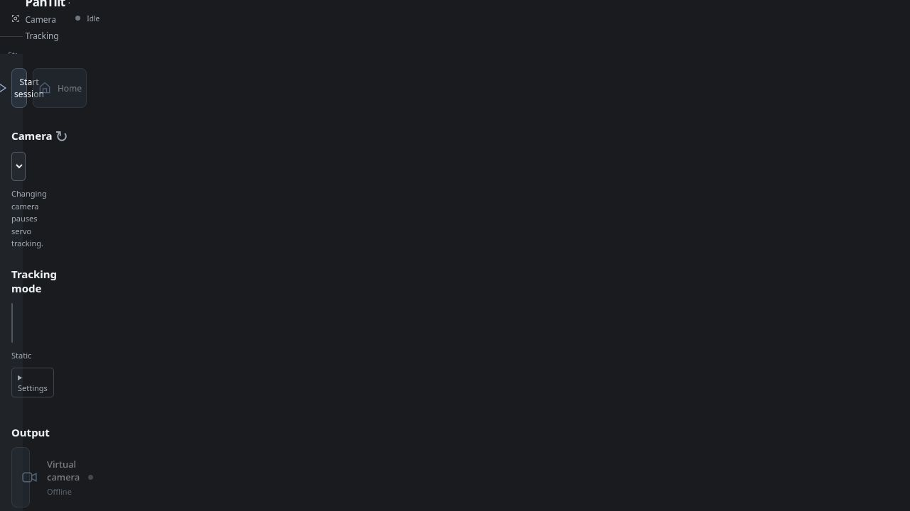

# PanTilt · Camera Tracking: usage guide

The application displays live video in the browser. YOLO handles faces and
MediaPipe handles hands using the already tested `dx,dy` controller settings.
No camera is opened until you click **Start session**.

## Run

From the project root:

```bash
.venv/bin/python -m pip install -r requirements.txt
.venv/bin/python python/web_app.py --camera 2
```

From `python/`:

```bash
../.venv/bin/python web_app.py --camera 2
```

Open [Camera studio](http://127.0.0.1:5000). Close other tracking scripts before
starting a session so they do not compete for the camera or serial port.

1. Click **Start session**. A freshly launched app defaults to **Static**, with motion off.
2. Choose **Face**, **Hand**, or **Static**, using the buttons or F/H/S keys.
3. Selecting Face or Hand automatically enables **Servo tracking** and connects
   the Arduino.
   Hand movement is active only while a thumb-index pinch is held.
4. Disable tracking to hold the current position while continuing detection.
5. **Stop session** closes camera, serial, MediaPipe and virtual output.

Static mode skips detection and sends no movement corrections. Entering it
from active tracking sends `0,0` and clears filter history. The initial static
session does not open serial, avoiding an Arduino reset just to view video.
After tracking has connected, the serial port stays open until session stop.
Selecting Face or Hand again re-enables tracking, including after a manual
pause. Preview-only sessions always keep servo movement disabled.

The web process owns the session independently of browser tabs. Closing a tab
does not stop the camera or virtual output: use **Stop session** or Ctrl+C in
the terminal. Multiple tabs share the same worker and controls.

## Virtual camera output on CachyOS

OBS is not required for this implementation. `pyvirtualcam` writes clean BGR
frames to a `v4l2loopback` device; browser preview alone includes landmarks.
Output is off by default and is controlled independently of servo movement.
It also works in Static mode. Audio remains configured separately in your video application.

The development machine uses a CachyOS kernel with `v4l2loopback` available.
On other machines, its availability depends on the installed kernel/module.
Create the virtual device (the command may request your system password):

```bash
sudo modprobe v4l2loopback video_nr=10 card_label=PanTilt exclusive_caps=1
```

Run this after a reboot if `/dev/video10` is missing. Do not reuse a physical
camera device number. If the module was already loaded with other settings,
inspect `v4l2-ctl --list-devices` rather than unloading an in-use module.

Then:

1. Start a session and enable **Virtual camera**.
2. Wait for **Live** on the output button. Click it again to disable output.
3. In Google Meet video settings, choose **PanTilt** as the camera.
4. If it is not listed, reload Meet after enabling virtual output.

`exclusive_caps=1` lets the loopback device appear as a capture device after a
producer attaches, which is important for Chromium/WebRTC applications.
See [v4l2loopback](https://github.com/v4l2loopback/v4l2loopback) and
[pyvirtualcam Linux support](https://github.com/letmaik/pyvirtualcam#linux).
The app enables a virtual device; it does not join a meeting or change Meet's
selected camera automatically. Turning output off closes the producer; Meet
may show the last frame or report an unavailable camera until changed there.

## Hide local preview

Use **Hide preview** below the video to stop JPEG encoding and disconnect
browser preview streaming. **Show preview** restores it without restarting
the session. Capture, detection, servo tracking and virtual output continue.
This saves preview encoding and browser work, not inference work. Like other
session controls, preview visibility is shared across connected app tabs.

## Capture and tracking resolution

The app requests 1280×720 at 30 FPS using MJPEG. Both browser preview and
clean virtual output use the actual captured resolution, shown below the
preview. A camera may negotiate a different size or deliver fewer frames.
The browser preview uses JPEG quality 90; virtual output uses the original
BGR frame without the preview's JPEG compression or annotations.

Both detectors receive a separate image reduced to at most 640 pixels on
its longest side (640×360 for 720p), preserving aspect ratio. YOLO retains
`imgsz=320`. Face boxes and normalized hand landmarks are mapped onto the
HD preview. Servo errors are normalized to the original 640×480 control
coordinates, preserving the configured gain, deadband and maximum step.

HD capture, resizing, preview encoding and virtual output still consume more
CPU and bandwidth. They share the existing worker with inference, so 30 FPS
is a requested rate rather than a guarantee. A change in camera field of view
or aspect ratio may also affect detection and framing.

## Home position

During a session, **Home** selects Static mode, pauses servo tracking and sends 50 `H` commands
at least 50 ms apart. The matching firmware moves up to 2 degrees per command
toward pan 80° and tilt 100°. This covers the full 0–180° range without
maintaining an estimated position in Python. Camera preview and virtual
output continue. Frame processing can make the sequence take longer than
2.5 seconds; opening serial for the first time adds the existing startup wait.

The mode stays Static afterward; select Face or Hand to resume tracking. Stop session
cancels the remaining commands. Home is disabled in preview-only mode.
There is no position feedback: completion means the command sequence was sent,
not that physical arrival was measured. The firmware is stored at
`firmware/pan_tilt/pan_tilt.ino`; no firmware change is needed for existing H support.

## Camera selection

Choose a physical camera from **Camera source** before or during a session.
The refresh button rescans connected Linux capture devices without opening
a video stream. Metadata devices and virtual loopback cameras are excluded.
Changing camera pauses servo tracking; select Face or Hand again to resume.
Virtual output reconnects to the new source if enabled. The `--camera` option
still sets the initial source.

The preview follows the actual frame aspect ratio, without cropping or adding
black sidebars, and scales to the available browser height.

## Pinch tuning

Open **Settings** to adjust **Hand pinch** during a session. The slider ranges
from 5% to 60% of palm width (default 20%). Lower values require closer tips.
The threshold is thumb-tip/index-tip distance divided by the distance between
the index and pinky knuckles (landmarks 5 and 17). Distances are measured in
pixel coordinates first to account for the frame aspect ratio.

Release is 6 percentage points above activation (26% at the default).
Changes apply when you release the slider, without restarting Flask, and
reset the previous pinch state. The pinch value is saved automatically in `config/local-settings.json` and
restored after Flask restarts. This local file is excluded from Git. Missing
or invalid settings fall back to 20%. Other controls still start in Static
mode with motion and virtual output off. The preview reports the measured percentage.

This compensates for uniform changes in apparent hand size, not every pose:
a sideways palm or occluded landmarks can still affect the ratio. Missing,
out-of-frame or degenerate palm references stop tracking.

## Options

```bash
# Validate the UI, detection and virtual output without serial access.
.venv/bin/python python/web_app.py --preview-only

# Stable camera name, different serial path, virtual device or HTTP port.
.venv/bin/python python/web_app.py --camera /dev/v4l/by-id/YOUR_CAMERA \
  --serial-port /dev/ttyUSB0 --virtual-device /dev/video10 --port 5001
```

The web server binds only to `127.0.0.1`, without debug mode or the reloader.
It is a local control app, not a public deployment. Run one process. HTTP
controls use a page token and same-origin validation. No cloud service is
needed for preview or tracking.

## Files

```text
python/
├── web_app.py              # Flask routes and local launch
├── camera_devices.py       # Linux physical capture device discovery
├── tracking_service.py     # Single camera/serial/output worker
├── motion_control.py       # Shared movement policy using tested settings
├── tracking_config.py      # Model paths and tested motion settings
├── local_settings.py       # Persistent pinch preference
├── hand_detector.py        # MediaPipe inference
├── tracking_targets.py     # Targets, pinch and preview annotations
├── templates/index.html    # Dashboard markup
└── static/
    ├── app.css
    └── app.js
```

Live camera frames stay in memory; they are not saved. MJPEG viewers receive
the latest encoded frame rather than a growing queue. Virtual-camera errors
are shown separately so the local preview continues. Inference and output
frame rate still depend on camera and CPU throughput.

## Preview



## Validation

```bash
.venv/bin/python -m unittest discover -s tests -v
```

Tests cover mode switching, pinch release, static mode, stale inference after
pause, API validation, MJPEG, cleanup, and clean virtual output using fakes.
Actual Meet selection requires the loopback device to be created first.
For the implementation, formulas and classroom presentation plan, see the
[code walkthrough](code-walkthrough.md).
